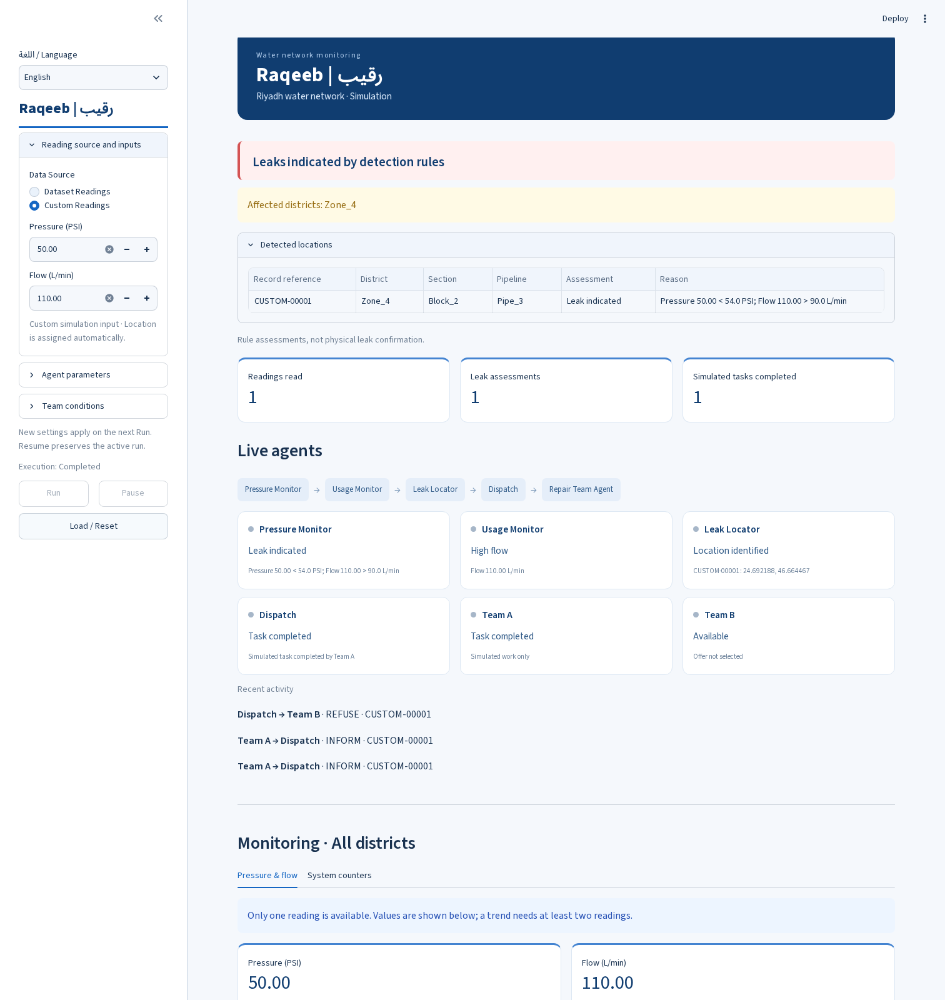
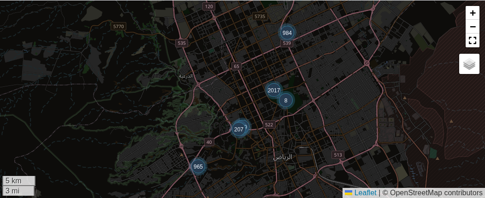

# Raqeeb | رقيب

Raqeeb is a Python multi-agent simulation for water-leak monitoring. It uses a Riyadh dataset to check pressure and flow readings, identify possible leaks, locate affected areas, and coordinate simulated repair tasks.

Five agent roles work together: Pressure Monitor, Usage Monitor, Leak Locator, Dispatch, and Repair Team. The dashboard supports Arabic and English and shows assessments, agent activity, messages, and repair-task progress across the network.

## Interface



### Map preview



## Getting started

Use Python 3.10 or later. Open CMD or PowerShell in the folder containing `app.py` and `requirements.txt`, then run:

```bat
python -m pip install -r requirements.txt
python -m streamlit run app.py
```

Open http://localhost:8501 if the app does not open automatically. Keep the terminal open while using the app. Press `Ctrl+C` to stop it.

If you downloaded the project as a ZIP, the files may be inside an extra `Raqeeb-main` folder.

No API key or LLM is required.

## Using the app

### Language

Choose Arabic or English from the sidebar. Arabic is the default.

Changing the language translates interface labels, agent states, charts, map details, and table headings without resetting the run or entered values. Original dataset identifiers and ACL protocol codes remain unchanged.

### Reading source

- **Dataset Readings:** All 5,000 records are prepared automatically in their original row order. Press Run to begin.
- **Custom Readings:** Enter pressure and flow values. Location and reference vibration come from the first original dataset record. This creates one unlabeled custom input; it does not generate additional readings or inherit `Leakage_Flag`.

### Run controls

- **Run:** Starts automatic processing of the prepared readings.
- **Pause:** Freezes messages, simulated work, and pending tasks.
- **Resume:** Continues from the same state.
- **Reset:** Clears execution using the current inputs.

Execution ends after the prepared readings and their tasks have been handled. Changing inputs or parameters prepares a new run on the next Run click.

### Simulation settings

Adjust pressure, flow, and major-case rules, simulated work duration, and playback interval. These are demonstration settings, not official engineering safety limits.

Team controls let you change availability, enable a one-time assignment failure for Team A or Team B, and restore teams. A failure takes effect only when that team is assigned, and each team can fail once per run.

Team starting locations are assigned from the original records with the minimum and maximum longitude. They represent simulated positions, not real maintenance depots.

## Dashboard

The light blue dashboard shows accumulated results across the network. It identifies affected districts and lists the related Section and Pipeline references automatically, without requiring a manual location selection.

A later normal reading does not remove an earlier leak assessment. These results are rule-based assessments, not proof of active physical leaks or completed real-world repairs.

The dashboard includes:

- A network-wide assessment summary.
- Agent activity and recent messages.
- Pressure and flow charts.
- Cumulative leak assessments and completed simulated tasks.
- A five-zone summary for the current run.

Pressure and flow appear as connected lines without point markers, following reading order across processed locations. The horizontal axis is not measurement time or a time series for one physical pipeline.

A single custom reading appears as numeric values because at least two observations are needed to draw a changing line. No additional readings are generated to create a trend.

The detail tabs are **Message log, Incidents, Dataset evaluation, Readings, and Map**.

User-facing labels are **District, Section, and Pipeline**. The original CSV columns remain `Zone`, `Block`, and `Pipe`.

## Agents and workflow

The system has five agent roles and six instances:

| Agent role | Responsibility |
|---|---|
| Pressure Monitor | Checks pressure readings |
| Usage Monitor | Checks flow readings |
| Leak Locator | Identifies the affected location |
| Dispatch | Coordinates assignment to an available repair team |
| Repair Team | Represents Team A and Team B and handles simulated tasks |

Reading validation and result recording are ordinary functions, not additional agents.

### Detection rules

The default rules are:

- Pressure below **54 PSI** and flow above **90 L/min**: leak assessment.
- Only one threshold crossed: suspected.
- Neither threshold crossed: normal.
- A dual-rule assessment with pressure at or below **40 PSI**: supervisor approval required.

`Leakage_Flag` is used for evaluation and never enters the detection logic.

### Team coordination

Available teams exchange `CFP`, `PROPOSE`, `ACCEPT`, and `REFUSE` messages. Dispatch selects the nearest straight-line offer.

Repair work is simulated and does not change source readings. If an assigned team fails, the system negotiates again with the remaining available team. If neither team is available, the workflow ends with an explicit unresolved outcome.

Messages retain sender, receiver, performative, content, ontology, IDs, record references, execution step, and UTC runtime timestamp.

## Messages and incident history

**Message log** shows every actual message in the current run, in its original order. It includes a total count and places sender, receiver, type, and content first. The downloadable log contains the same complete raw messages.

The **Recent activity** preview is separate from the full message log.

**Incidents** records each actual assignment attempt, including:

- Team name.
- Assigned, In progress, Failed, or Completed state.
- Reassignment source.
- Execution steps.
- Overall incident outcome.

Failed attempts remain visible even if another team completes the task. Teams that only submitted offers or were unavailable are not marked as assigned or completed. Later readings do not erase earlier incident history.

The agent-flow strip shows Repair Team Agent as one role, while the individual Team A and Team B cards show their execution details.

## Map

The map displays the original dataset coordinates with record-count clusters, pan, zoom, fullscreen, a background toggle, and clickable details.

It automatically highlights an assessed problem location. Cyan and coral marker colors represent dataset labels, separately from runtime assessments.

Records sharing a `Location_Code` can have different coordinates. Their positions are never averaged or reassigned.

OpenStreetMap provides the geographic background only, with attribution preserved. Map assets and tiles require internet. If tiles fail to load, the app displays a translated warning, and coordinate tables remain available.

No pipeline routes, flow directions, or sensor connectivity are invented.

## Dataset and evaluation

The supplied file is:

`data/riyadh_leakage_dataset_with_units.csv`

It contains 5,000 rows and ten columns and is preserved byte for byte, including its 323 positive labels, field names, precision, identifiers, and per-record coordinates.

An in-memory reference such as `CSV-00001` and a one-based Original Reading Index identify individual rows.

The dataset has no measurement timestamps or pipeline connectivity fields. Its demonstration coordinates have not been independently verified as infrastructure locations. Flow readings do not represent leak rate or water loss.

With the default rules, agreement with the supplied dataset labels is:

| Metric | Result |
|---|---:|
| True positives | 323 |
| True negatives | 4,643 |
| False positives | 34 |
| False negatives | 0 |
| Accuracy | 99.32% |
| Precision | 90.48% |
| Recall | 100% |
| F1 score | 95.00% |

These results measure agreement with the same dataset labels. They are not held-out machine-learning results or real-world validation.

## Testing

Run the technical checks with:

```bat
python -m unittest discover -s tests -v
python tests/verify_runs.py
```

For manual testing, enter the readings yourself:

| Test | Pressure (PSI) | Flow (L/min) | Additional setting |
|---|---:|---:|---|
| Normal reading | 65 | 80 | None |
| Dual anomaly | 50 | 110 | None |
| Reassignment | 50 | 110 | Enable Team A assignment failure |
| Major-case approval | 35 | 110 | None |

Team A's failure takes effect only if it wins the nearest-team negotiation. The technical verification fixes its position to make this reproducible.

No preset scenarios are loaded. Use the sidebar controls, actual message logs, and screenshots to document the required three manual scenarios.

## Project structure

| Module | Purpose |
|---|---|
| `data_loader.py` | Dataset validation and record references |
| `protocol.py` | Agent messages |
| `agents.py` | Agent behaviors |
| `simulation.py` | Execution scheduler |
| `controls.py` | Automatic inputs |
| `presentation.py` | Network summaries and charts |
| `i18n.py` | Arabic and English translations |
| `app.py` / `ui.py` | Streamlit interface |

Execution state belongs to the current browser session and is not stored in a durable database.

## Documentation

- [Model design and PEAS](docs/model_design.md)
- [Verification](docs/verification.md)
- [Technical run exports](docs/verification/)
- [Academic report draft](docs/report.md)
- [Submission checklist](docs/requirements_review.md)

Academic report drafts are separate from the application interface. The final report, Business Model Canvas, poster, presentation, repository collaborator access, and Blackboard submission remain the team's responsibility.

Development verification does not represent group-member participation. The application does not submit academic work automatically or perform physical maintenance.

## شرح مختصر

رقيب نظام محاكاة بلغة Python يستخدم خمسة ادوار من الوكلاء لمراقبة الضغط والتدفق، تحديد الاشتباه بالتسرب، وتنسيق مهام الصيانة المحاكية.

اختاري العربية او الانجليزية من السايدبار. الداتا جاهزة تلقائيا، واضغطي تشغيل لبدء المعالجة. وللتجربة اليدوية، ادخلي الضغط والتدفق بنفسك.

تعرض الواجهة النتائج لجميع المناطق وتحدد المواقع المتأثرة تلقائيا. تقدرين تتابعين حالات الوكلاء ورسائلهم ومحاولات اسناد المهام، وتختبرين تعطل الفرق واعادة الاسناد من اعدادات السايدبار.

النتائج ومهام الصيانة داخل النظام محاكاة، وليست تأكيدا لتسربات او اصلاحات فعلية.