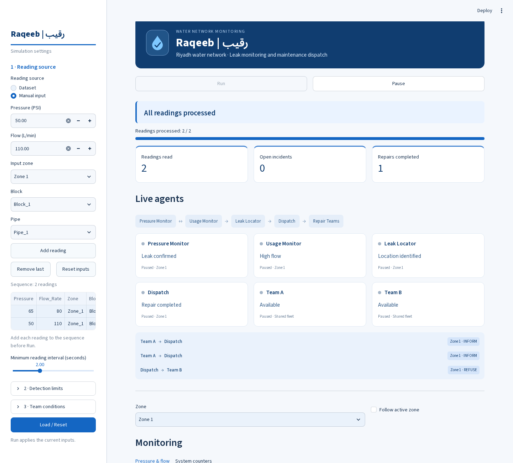

# Raqeeb

A Python multi-agent water-leak simulation for five operating zones in Riyadh. Two shared repair teams serve the whole simulated network.

## Run

Use Python 3.10 or later. Open a terminal in the folder containing `app.py`.

```bash
python -m pip install -r requirements.txt
python -m streamlit run app.py
```

Choose **Dataset** to process the source data from a selected starting row, or **Manual input** to enter pressure, flow, Zone, Block and Pipe. Manual defaults are 65 PSI and 80 L/min at Zone_1/Block_1/Pipe_1, with both teams available and no injected failure. Team A and Team B availability can be set independently. There are no preset scenarios in the interface.

With Manual input, Run uses the current reading when the sequence is empty. **Add reading** appends the current values to an ordered sequence; when a sequence exists, add each intended reading before Run. **Remove last** removes its last entry. **Reset inputs** clears the sequence and restores default manual fields and team conditions. Both sources stop at their final reading.

**Run** applies changed inputs as a new run. If inputs have not changed, **Pause** then **Run** resumes the existing run. Editing applied settings pauses it. **Load / Reset** restarts using the current inputs. Detection limits remain adjustable; the agents determine the outcome rather than the user choosing a state.

The top panel shows live agent roles, zone and recent messages. Monitoring has exactly three charts: pressure, flow, and confirmed incidents versus completed repairs. System counters show messages, team failures and execution errors. Map, message log, incidents and evaluation follow. **Riyadh overview is the final section**, with five zone cards. A View button selects that zone's charts and map; Follow active zone tracks incoming readings.

## Agents and shared teams

Pressure Monitor and Usage Monitor confirm a leak only when both pressure and flow are abnormal. Leak Locator identifies the incident. Dispatch requests approval for major leaks and compares team offers. Team A and Team B are shared by all five zones. A reservation prevents assigning one team to overlapping tasks; busy teams refuse, and incidents wait until a team is free. Availability is rechecked when an offer is accepted. Teams retain their last repair position. A failed team remains unavailable for the rest of that run. These are two simulated teams, not ten teams or measured staffing needs.

At the dataset end, runnable repairs finish before the session stops. Pending approvals stay visible. Approving/rejecting one can resume its workflow without rereading data. Rejected or unserviceable incidents remain open. Repeated alerts for an open pipe are merged.

## Data and display positions

The CSV retains 5,000 synthetic records: pressure in PSI, flow in L/min, Zone, Block, Pipe, latitude, longitude and a reference leakage label. `Leakage_Flag` is used only for evaluation. Source: Talha.97S, [Smart Water Leak Detection Dataset](https://www.kaggle.com/datasets/talha97s/smart-water-leak-detection-dataset). See [dataset license](data/LICENSE.txt).

The source CSV coordinates remain unchanged. Display positions are generated around Riyadh for five fictional operating zones: Central, North, South, West and East. They are not official district boundaries or actual utility measurements. Each zone has 5 blocks and 25 pipe identifiers, giving 125 unique pipes. The simulated footprint is about 19 × 18 km; it represents a local demonstration network, not all of Riyadh. The team's initial positions are invented starting points, not maintenance centers from the data. Distances are straight-line.

The source has no timestamps. Charts show arrival times in the simulation. A zone chart combines readings from different pipes; it must not be presented as a historical record from one sensor. Team locations, approval actions and repair duration are simulation state.

## Checks and report

```bash
python -m unittest -v test_simulation.py test_monitoring.py test_manual_input.py
```

Tests include full-dataset traversal, Pause/resume, separate agent steps, approvals, failure recovery, fixed positions, bounded logs, shared-team waiting and prevention of double booking.

- [Project report](docs/report.md)
- [Model design](docs/model_design.md)
- [Requirements review](docs/requirements_review.md)

Default detection limits give TP=323, FP=34, TN=4643 and FN=0 on the original synthetic data. Accuracy is 99.32%, precision 90.48%, recall 100% and F1 95%. These are descriptive results using limits selected after inspecting the dataset, not independent validation on Saudi utility measurements.

History retains 600 observations/monitoring samples, 1,500 messages/traces, and 500 recent incidents plus all open incidents. Session counters remain cumulative. The browser session must stay open to advance. Adding group members and instructors as repository collaborators is still a submission task to complete.

Manual readings have no reference labels and do not change the CSV. Dataset evaluation always uses the original 5,000 labelled records, including when running manual input.


