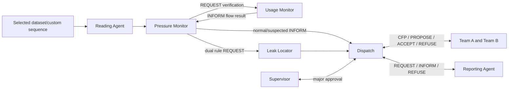

# Model design

## Architecture

The supplied Phase 1 architecture is retained. Reading and Reporting agents are supporting infrastructure rather than a replacement four-agent design. Two Repair Team instances represent the approved Repair Team role. No task claims a physical intervention.

One scheduler advances one queued message per execution step and ticks pending simulated team work. Readings are processed serially; the next starts only after the current workflow, communication and report tasks have drained. UI reruns render the same session-owned Simulation instance. A monotonic clock gates execution steps at the configured application interval. Navigation never consumes an additional step before the interval is due.

## Roles, PEAS and types

| Agent | Tasks and decision rule | Performance | Environment | Actuators | Sensors/percepts | Type and justification |
|---|---|---|---|---|---|---|
| Reading Agent | Validate required fields and coordinates; strip leakage label from delivery | Valid records delivered once; invalid records explicitly rejected | Configured input sequence | REQUEST delivery; validation event | Selected row/custom input | Reactive: responds directly to incoming reading request |
| Pressure Monitor | Pressure < configured low limit; request independent usage verification; combine results | Rule-consistent assessment, no label leakage | One selected reading and thresholds | REQUEST verification/localization or INFORM assessment | Pressure and returned flow result | Hybrid: local reaction plus multi-message verification state |
| Usage Monitor | Flow > configured high limit | Correct independent flow check | Delivered measurement | INFORM result to pressure agent | Flow and verification request | Reactive: direct threshold response |
| Leak Locator | Copy exact record location, flag major when pressure <= major limit after dual confirmation | Correct record-coordinate association | Record reference and identifiers | REQUEST dispatch with exact location/severity | Confirmed dual-rule request and source coordinates | Reactive: deterministic location lookup, no fabricated route search |
| Dispatch | Major approval; CFP negotiation; choose smallest offered straight-line distance, tie by team name; coordinate reporting and bounded retries | Acknowledged outcomes, available-team allocation, explicit terminal failures | Active task, offers, supervisor, report deadlines | CFP, ACCEPT, REFUSE, report REQUEST | Assessments, team offers/refusals/completions, report acknowledgments | Deliberative: maintains approval, offer and retry state to select actions |
| Repair Team A/B | Offer if available; refuse if unavailable; perform finite simulated task; optional configured A failure | Consistent availability, one accepted simulated task completed or failed | Configured team reference coordinate and current reading | PROPOSE, REFUSE, INFORM | CFP, ACCEPT, configured availability and fault | Hybrid: responds to messages and maintains multi-step task state |
| Reporting Agent | Store each task once, acknowledge or deliberately refuse/drop acknowledgment | Traceability, exactly one stored row per task reference | Report store and reporting task | INFORM acknowledgment or REFUSE | REQUEST, availability/fault configuration | Reactive: request-driven idempotent reporting |

Each instance exposes its execution state, latest action, actual last activity UTC runtime timestamp and any failure details. A failure is an agent/software condition, not a disconnected physical sensor.

## Environment classification

- **Accessible:** selected input records, all agent states and configured parameters are visible to the simulator. This does not imply access to a real water network.
- **Deterministic:** fixed inputs, configuration and supervisor actions yield the same assessments and ordered outcomes. UUIDs/runtime timestamps identify execution but do not alter decisions.
- **Dynamic while running:** pending work, queue and timeout counters change automatically between user interactions. Pause freezes the simulation completely.
- **Discrete:** finite records, messages and integer scheduler steps. Measurements are real-valued data, but the environment advances discretely.

## Parameters and variables

| Name | Default | Purpose and effect |
|---|---|---|
| pressure_limit | 54 PSI | Strictly lower pressure triggers one anomaly |
| flow_limit | 90 L/min | Strictly greater flow triggers the second anomaly |
| major_limit | 40 PSI | A dual-rule leak at/below this value waits for supervisor approval; must be below pressure_limit |
| timeout_steps | 20 | Running-step deadline for report acknowledgment; not a wall-clock measurement timestamp |
| retries | 1 | Extra requests after initial reporting attempt, bounded 0–5 |
| team_steps | 4 | Finite simulated task duration, not measured physical repair time |
| playback_interval | 0.5 application seconds | Minimum wall-clock gap between scheduler steps; not source sampling frequency |
| team_a/b_available | true | Which simulated teams can offer tasks |
| fail_team_a | false | One deliberate Team A assignment failure per run |
| reporting_unavailable | false | Reporting Agent refuses requests until restored |
| reporting_silent | false | Drop acknowledgments to demonstrate timeout exhaustion |
| team coordinate references | first and last dataset records | Explicit configurable simulation start positions, not depots |
| cursor / current_ref / step | 0 / none / 0 | Position, exact active record and execution step |
| pending_reports | empty | Content, attempts, deadline and source reference for each reporting task |
| reports / outcomes / events | empty | Actual traceable observations, distinct from user expected outcome |

Thresholds are demonstration rules consistent with earlier project work. They are not calibrated engineering safety thresholds. Vibration is validated, preserved and visualized, but is not an input to the approved pressure/flow decision. Leakage_Flag is never delivered into detection agents. Rule evaluation uses it only as target data.

## Protocols

Every ACL-like message has sender, receiver, performative, content, ontology `raqeeb.water-monitoring.v1`, unique message ID, run/record conversation ID, runtime UTC timestamp, execution step, record reference and optional task reference.

1. Environment REQUESTs Reading Agent validation; Reading REQUESTs Pressure Monitor with label-free measurements.
2. Pressure REQUESTs Usage Monitor verification; Usage INFORMs independent flow result.
3. Pressure REQUESTs Locator when both anomalies agree; otherwise INFORMs Dispatch of Normal/Suspected.
4. Locator REQUESTs Dispatch with exact record coordinates. A major assessment waits for Supervisor ACCEPT/REFUSE.
5. Dispatch issues CFP to both teams. Available teams PROPOSE their computed straight-line distance; unavailable/failed teams REFUSE. Dispatch ACCEPTs the closest offer and REFUSEs the unused offer. Team INFORMs accepted/completed or failed; failure triggers re-negotiation with the remaining team.
6. Dispatch REQUESTs Reporting Agent with unique task reference; Reporting INFORMs completion or REFUSEs unavailability. Missing acknowledgments trigger bounded retries using the same task reference. Idempotence prevents duplicate report rows. Exhaustion creates a report_failed event and terminal Failed run after remaining tasks drain.

For concrete payloads, inspect the committed verification JSON logs. Those are actual executed messages, not prerecorded interface content.

## State and failure semantics

Ready → Running ↔ Paused → Completed/Failed. All execution, including already-running team work and deadlines, freezes during Pause. Restoring an agent records a user action but creates no dispatch while paused. Resume continues the same queue. Completed means selected workflows have finished; a completed unresolved/rejected outcome is still explicitly unresolved, not a repaired pipe. Failed means validation, execution or exhausted reporting tasks failed. A handled Team A failure followed by successful Team B completion can still produce Completed, with the failure event retained.

No interpolation, generated future readings, pipeline routes, measurement times, physical sensor states or water-loss estimates are added. Approved Phase 1 dispatch is demonstrated solely through simulated team state, without altering the source readings.
