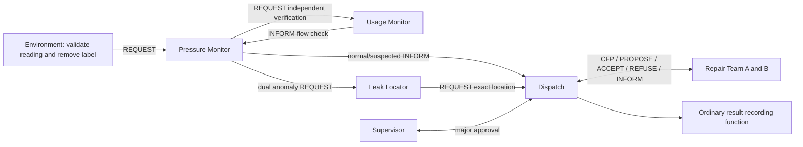

# Model design

## Approved architecture

Raqeeb implements the five Phase 1 agent roles. Pressure Monitor, Usage Monitor, Leak Locator and Dispatch each have one instance; Repair Team has two instances (A/B). There are six instances of five roles. Reading validation and result recording are ordinary `Simulation.deliver_reading` and `Simulation.record_report` functions, not independent agents. No Reading Agent or Reporting Agent is instantiated or exchanges messages.

One scheduler advances one queued message per execution step and ticks pending simulated team work. Readings are serial: the next starts after the current workflow, messages and simulated team tasks finish. The reliable in-process queue is not a distributed network transport.

## PEAS and agent type

| Role | Main behavior and contribution | Performance | Environment | Actuators | Sensors/percepts | Type and justification |
|---|---|---|---|---|---|---|
| Pressure Monitor | Pressure < low limit; request independent flow verification; combine both checks | Correct rule assessment without label leakage | Current validated reading, thresholds and verification response | REQUEST to Usage/Locator, INFORM to Dispatch | Pressure and Usage reply | Hybrid: local reaction plus a multi-message verification workflow |
| Usage Monitor | Independently compare flow > high limit | Correct flow check | Delivered reading and configured flow limit | INFORM verification result | Flow and verification request | Reactive: direct request-driven threshold check |
| Leak Locator | Preserve exact per-record coordinates and identifiers; major flag only after dual confirmation | Correct location/severity reference | Assessment, original/custom record and major threshold | REQUEST dispatch | Reading coordinates and pressure | Reactive: deterministic location/severity lookup |
| Dispatch | Major approval; compare team offers; choose nearest available team; reassign after failure | Appropriate allocation, explicit rejection/unresolved/completed outcomes | Active task, offers, availability and supervisor decision | CFP, ACCEPT, REFUSE; call ordinary recording function | Assessments, offers/refusals, failure/completion INFORM | Deliberative: maintains approval and offer state to choose actions |
| Repair Team A/B | Offer if available, refuse otherwise; perform finite simulated work; optional A assignment failure | Accepted simulated tasks completed or explicitly failed | Automatically assigned dataset coordinate and current task | PROPOSE, REFUSE, INFORM | CFP, ACCEPT, availability/failure configuration | Hybrid: reactive communication with persistent multi-step task state |

Each instance exposes state, latest action and runtime last-activity timestamp. Team failure is a software simulation condition, not a disconnected sensor.

## Environment classification

- **Accessible:** simulator inputs, agent states and configured parameters are visible; no real water-network access is claimed.
- **Deterministic:** fixed readings, configuration and user decisions yield the same assessments and message order. UUIDs and runtime timestamps identify runs without affecting decisions.
- **Dynamic while running:** the scheduler changes queue/task state between user actions. Pause freezes execution.
- **Discrete:** records, messages and integer steps; measurements remain real-valued inputs.

## Variables and parameters

| Parameter/state | Default | Effect |
|---|---|---|
| pressure_limit | 54 PSI | Pressure strictly below this value is one anomaly |
| flow_limit | 90 L/min | Flow strictly above this value is the second anomaly |
| major_limit | 40 PSI | A dual-rule result at/below this pressure requires approval; must be below low-pressure limit |
| team_steps | 4 | Finite simulated task duration, not physical repair time |
| playback_interval | 0.5 seconds | Minimum wall-clock gap between execution steps, not measurement sampling time |
| team_a/b_available | true | Which teams can offer tasks |
| fail_team_a | false | One deliberate A assignment failure per run |
| team coordinate references | minimum/maximum longitude dataset rows | Automatic exact-coordinate simulation positions, not real depots |
| cursor/current_ref/step | 0/none/0 | Reading position, source reference and execution step |
| offers/assigned | empty/none | Actual negotiation state |
| reports/outcomes/events | empty | Traceable records written by ordinary functions, actual task outcomes and failure events |

There are no reporting-agent availability, report-timeout or reporting-retry settings. Team A can fail once and then refuses subsequent offers until restored. Dispatch re-negotiates against the remaining available team; if no team is available it records an unresolved outcome and terminates that workflow rather than retrying indefinitely.

## Communication

ACL-like messages contain sender, receiver, performative, content, ontology `raqeeb.water-monitoring.v1`, conversation/message IDs, runtime UTC timestamp, execution step and record/task references.

1. The environment validates the row, removes Leakage_Flag and REQUESTs Pressure Monitor directly. Invalid rows create explicit validation-failure events without entering detection.
2. Pressure REQUESTs Usage verification; Usage INFORMs its independent flow result.
3. Pressure REQUESTs Locator for a dual anomaly, otherwise INFORMs Dispatch of Normal/Suspected.
4. Locator REQUESTs Dispatch using the exact reading coordinates. Major results wait for Supervisor ACCEPT/REFUSE.
5. Dispatch sends CFP to A/B. Available teams PROPOSE computed straight-line distances; unavailable/failed teams REFUSE. The minimum offer wins (ties by team name). Dispatch ACCEPTs the winner and REFUSEs an unused offer. The team INFORMs accepted/completed or failed. Failure triggers a new offer round.
6. Dispatch records assessments/outcomes through `record_report`. These local calls are not ACL messages and do not impersonate an agent.

## UI and data integrity

Arabic and English are supported. Presentation labels are **District / Section / Pipeline**, mapping to original **Zone / Block / Pipe** fields. Identifiers such as Zone_4 and original CSV columns/bytes remain unchanged. Vibration is retained but not part of the approved pressure/flow rule. Ground-truth labels never enter detection.

Inputs and team coordinates are prepared automatically. The main dashboard aggregates all assessed districts and identifies affected record locations. Later normal readings do not hide earlier leak evidence. Pressure/flow use actual reading-order lines; one custom row is displayed as values. Cumulative simulated work uses integer execution steps. Original timestamps, pipeline routes, connectivity, water loss and future readings are never invented.

The title card is outside the timed Streamlit fragment. Only the dynamic dashboard advances/rerenders on the timer. Routine steps do not call full-app rerun; completion or explicit user controls may rerun the app. This keeps the title's DOM node stable during playback. The Simulation object is session-owned and retained across language/tab changes.

Ready → Running ↔ Paused → Completed/Failed. Pause freezes all message/task progression. Restoring a team records an explicit user event without dispatching while paused. Completed may include a clearly recorded rejected/unresolved workflow; it does not prove physical repair. Failed covers validation or execution errors. A handled team failure can end Completed after successful reassignment.
