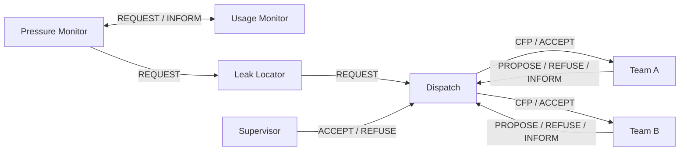

# Model design

## Network and agents

Raqeeb simulates five operating zones within Riyadh. It has five agent roles: Pressure Monitor, Usage Monitor, Leak Locator, Dispatch and Repair Team. The Repair Team role has exactly two instances shared across the network. Zones do not own separate teams.

Each reading takes three visible sensor-check steps. Confirmed incidents enter the corresponding zone's queue. One workflow per zone advances independently, while both teams share a central reservation table. No team can own two repair tasks at once. Each accepted offer is checked against current availability. Stale offers trigger another offer round. If both teams are busy, the incident waits and retries when capacity becomes available. If teams are disabled or failed, the incident remains unresolved. Position changes are retained after repair completion.

## PEAS and agent types

| Agent / type | Performance | Environment | Actuators | Sensors | Justification |
| --- | --- | --- | --- | --- | --- |
| Pressure / Reactive | Correct joint confirmation | Reading and flow reply | REQUEST check and location | Pressure and INFORM reply | Uses threshold rules |
| Usage / Reactive | Correct flow check | Current reading | INFORM pressure agent | Flow and request | Reacts to current values |
| Locator / Reactive | Correct pipe identifiers and position | Virtual network | REQUEST dispatch | Confirmed reading | Extracts known location fields |
| Dispatch / Deliberative | Assign nearest available team and respect approval | Incident, offers, fleet reservations | CFP, ACCEPT, REFUSE | Proposals, availability, failure/completion and approval | Compares alternatives and replans |
| Repair Team / Hybrid | Complete assigned task or report inability | Position, reservation and task | PROPOSE, REFUSE, INFORM | CFP and ACCEPT | Reacts to requests and maintains a multi-step task |

## Environment and variables

The simulation is accessible because it exposes its inputs and states. Decisions are deterministic for the same inputs and user actions. The world is dynamic during execution. The simulation is discrete because scheduling, messages and state changes advance in ticks. Pressure, flow and coordinates are continuous-valued inputs. Actual Python execution duration varies by machine. These classifications describe the simulator, not the real water network.

| Variable | Default | Effect |
| --- | --- | --- |
| Pressure limit | 54 PSI | Strictly lower is abnormal |
| Flow limit | 90 L/min | Strictly higher is abnormal |
| Major pressure limit | 40 PSI | Confirmed leak at or below this needs approval |
| Repair duration | 8 steps | Work duration after acceptance |
| Minimum reading interval | 2 seconds | Minimum time between starting readings |
| Team A failure | Off except failure scenario | Assignment triggers failure |
| Both teams unavailable | Off | No repair can start |
| Team position / owner | Shared fleet | Determines offers and prevents double booking |

One tick is 0.5 simulated seconds. A sensor check takes three ticks, so the reading interval is a minimum, not guaranteed real-time sampling. Run processes the selected row through the final row once. Pause freezes reading and repair progress. At the end, runnable work drains. Pending approvals stay visible and can resume work without rereading rows.

## Locations

Zone_1 is centered at (24.7136, 46.6753), Zone_2 at (24.7736, 46.6753), Zone_3 at (24.6536, 46.6753), Zone_4 at (24.7136, 46.6093), and Zone_5 at (24.7136, 46.7413). The labels Central, North, South, West and East describe fictional operating areas, not official districts.

Pipe display latitude = zone latitude + (block number − 3) × 0.012. Longitude = zone longitude + (pipe number − 3) × 0.012. The 125 resulting positions span about 19 × 18 km around Riyadh. Team A starts at (24.7136, 46.6653), Team B at (24.7336, 46.7053). These are invented starting points; no maintenance-center dataset is used. Haversine distance compares offers. Source values and original coordinates remain unchanged in the CSV.

## Messages

Messages include sender, receiver, performative, content, ontology (`water-leak`), conversation ID, step, zone, source row and simulation time. A reading has a unique conversation ID. Delivered/cancelled fields distinguish processed messages and merged duplicate requests.

| Sender → receiver | Performative | Purpose |
| --- | --- | --- |
| Pressure → Usage | REQUEST | Check flow for the same reading |
| Usage → Pressure | INFORM | Return high-flow result |
| Pressure → Locator | REQUEST | Locate confirmed incident |
| Locator → Dispatch | REQUEST | Send area, position and severity |
| Supervisor → Dispatch | ACCEPT / REFUSE | Allow or reject dispatch |
| Dispatch → teams | CFP | Request distance offers |
| Team → Dispatch | PROPOSE / REFUSE | Offer availability or decline |
| Dispatch → chosen team | ACCEPT | Start reserved task |
| Team → Dispatch | INFORM | Accepted, unavailable, failed or completed |

Unavailable after acceptance means an offer became stale; dispatch starts a new round. Team failure is distinct from a Python execution error. Repeat alerts for an open Zone/Block/Pipe merge into that incident.

## Scenarios and interface

1. Normal, row 1: pressure and flow are normal; monitor checks end without dispatch.
2. Minor leak, row 36: both limits are exceeded; the closest available shared team repairs the incident automatically.
3. Major leak and team failure, row 567: the incident waits for approval, other zones keep monitoring, Team A fails when assigned, and Team B completes the repair. Rejecting approval leaves the incident unresolved.

The interface starts with live agent activity and messages. It keeps exactly three charts: pressure, flow, and confirmed incidents versus repairs. Counters show messages, team failures and execution errors. Map, message log, incident list and evaluation follow. The final section is Riyadh overview with five operating-zone cards.
