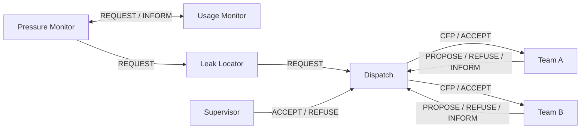
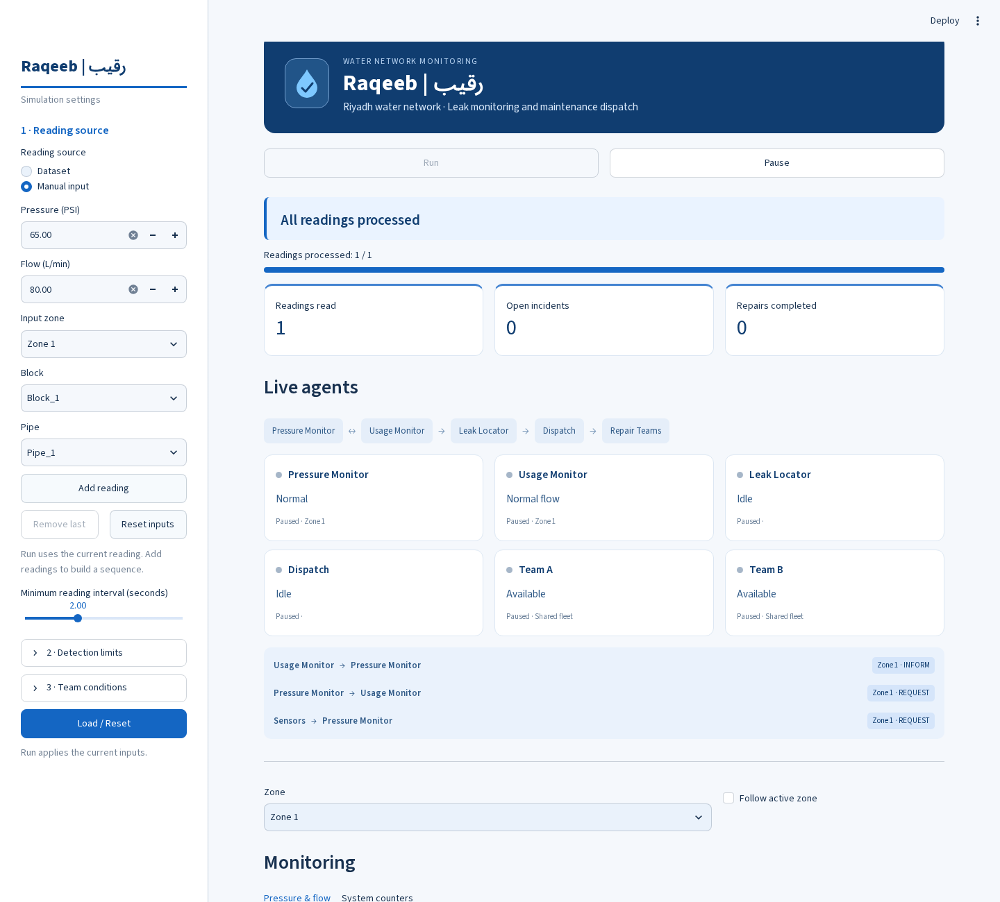
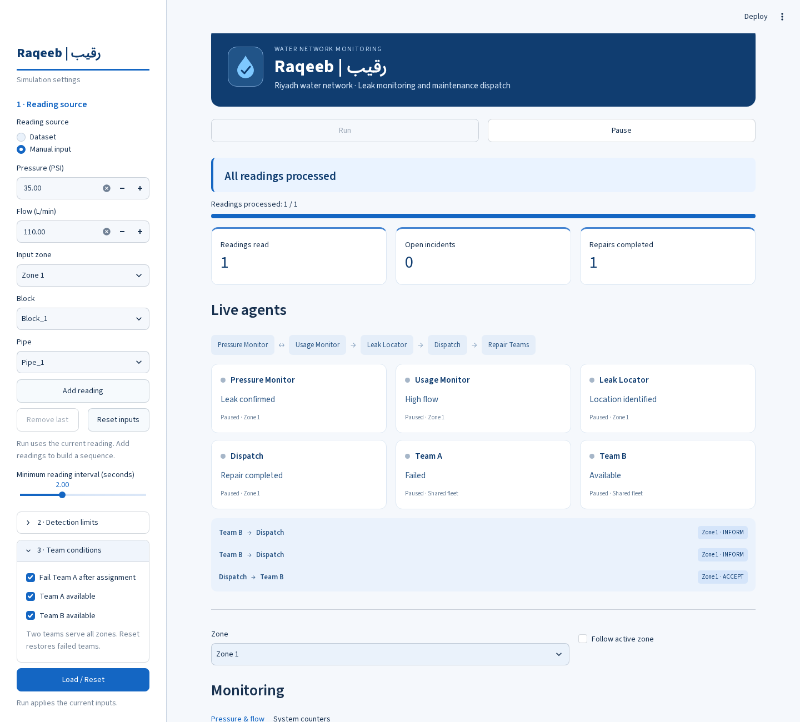

# RAQEEB
## A Multi-Agent Water Leak Simulation for Riyadh

## Abstract

Water leaks can waste treated water and delay maintenance when unusual sensor readings are not checked quickly. Raqeeb is a Python multi-agent simulation that demonstrates how monitoring and repair coordination can work together in a local water network. It represents five fictional operating zones in Riyadh, with five blocks and twenty-five pipe identifiers per zone. Pressure Monitor and Usage Monitor check the same incoming reading and confirm a leak only when both pressure and flow are abnormal. Leak Locator identifies the affected pipe, while Dispatch compares offers from two shared repair teams. Major incidents need supervisor approval before dispatch. Team reservations prevent overlapping assignments, and a failed team can be replaced by the other team. An interactive interface shows agent activity, messages, readings, incidents and repair progress. The system supports 5,000 synthetic source records and user-entered readings or sequences. Original values and labels are preserved for dataset evaluation. Riyadh display coordinates and team positions are simulated, so the project is not connected to a real utility network. Tests cover normal readings, confirmed leaks, approval, unavailable teams, failure recovery and competing tasks. The main objectives are to demonstrate cooperative detection, reduce unnecessary dispatch, respect human approval and make maintenance coordination easier to follow. The intended users are water-network supervisors, maintenance planners and students studying agent-based systems.

## 1. Introduction

Undetected water leaks can waste water and increase maintenance effort. A single unusual pressure or flow reading does not always prove that a leak exists. Sending a team for every isolated anomaly can also create unnecessary work. Raqeeb addresses this problem through cooperating monitor agents and a separate dispatch workflow.

The project simulates a local network in Riyadh rather than the whole city. The five Zones in the source data become five fictional operating areas within the city. They share exactly two repair teams. This scope keeps the model small enough to explain and test while allowing agents to compare offers, wait for busy teams and recover from a failure.

### Target users

Water-network supervisors monitor incidents and approve major dispatches. Maintenance planners follow team availability and repair progress. Maintenance teams receive assignments through their simulated agents. Students can use the visible agent states and messages to study the system's decisions.

### Objectives

1. Detect unusual pressure and flow readings.
2. Require joint confirmation before dispatching a team.
3. Identify the affected Zone, Block and Pipe.
4. Select the closest available shared team.
5. Require supervisor approval for major incidents.
6. Handle a team failure without silently losing the incident.
7. Present decisions, messages and results in an interactive interface.

## 2. Data and scope

The Smart Water Leak Detection Dataset contains synthetic sensor readings and rule-based reference labels [1]. The retained CSV has 5,000 rows and eight columns: Pressure, Flow_Rate, Zone, Block, Pipe, Latitude, Longitude and Leakage_Flag. Pressure is in PSI and flow in litres per minute. The reference label is used only for evaluation. There are 323 positive labels and 4,677 negative labels. No retained row has missing values, and there are no fully duplicated rows. Multiple readings may refer to the same pipe; 323 labelled rows do not mean 323 separate physical leaks.

Temperature, vibration, RPM, operational hours and the redundant combined location code were omitted from the application dataset. Original retained values and labels were not changed. Original latitude and longitude remain in the CSV, while the interface uses generated Riyadh positions.

The five operating zones contain 125 unique Zone/Block/Pipe combinations. Their virtual footprint is approximately 19 km north–south by 18 km east–west. These positions are not official districts or real water-network topology. Team starting locations, availability, failures and repair duration are simulation inputs. There is no maintenance-center dataset. The source has no timestamps; chart time is simulated arrival time. Zone pressure/flow charts combine readings from different pipes and must not be described as a single sensor's measured time history.

## 3. Business Model Canvas

| Component | Proposed model |
| --- | --- |
| Value proposition | Help supervisors check anomalies, coordinate repair tasks and avoid unnecessary dispatch through joint confirmation. |
| Customer segments | Water utility operators, municipal network managers and large facilities with internal water networks. |
| Channels | Demonstrations, direct meetings, a product website and installation through network-service providers. |
| Customer relationships | Setup assistance, supervisor training, technical support and periodic updates. |
| Key resources | Python software, agent designs, sensor data, developers and water-network expertise. Real deployment would also require suitable sensors and integration access. |
| Key activities | Develop and test agents, calibrate detection rules, integrate readings, maintain software and train operators. |
| Key partners | Potential utility operators, maintenance providers and sensor suppliers. No actual partnership is claimed. |
| Revenue streams | Potential setup fees, software subscriptions, support contracts and network-expansion services. These are a proposed business model, not current income. |
| Cost structure | Software development, integration, testing, training, support and future hosting or hardware needs. |

## 4. Model design

### 4.1 Architecture and environment

All application logic and interface definitions are written in Python. Streamlit provides the interactive interface. Agents exchange queued messages locally; this is not a distributed utility-control system.

Each incoming reading takes three visible monitor steps. A joint confirmation creates an incident, unless that pipe already has an open incident. Each zone has a queue and one active incident workflow. The five workflows share a fleet reservation table containing only Team A and Team B. Both teams can repair different incidents at the same time, but one team cannot own two tasks. A team rechecks its reservation when accepting an offer. If an offer became stale, Dispatch requests new offers. An incident waits when both healthy teams are busy; disabled or failed teams cannot be selected.

A major incident waits for approval while monitoring of other zones continues. Dataset mode processes the selected starting row through the final row once. Manual input processes the current values or a user-built ordered sequence. There are no preset scenario selections. Pause freezes readings and repairs. After the final reading, runnable tasks finish. Pending approvals remain available without restarting the dataset. A tick represents 0.5 simulation seconds. Since each monitor conversation takes three ticks, the adjustable reading interval is a minimum interval.

### 4.2 Agents, PEAS and types

| Agent / type | Main responsibility | Performance measure | Environment | Actuators | Sensors | Reason for type |
| --- | --- | --- | --- | --- | --- | --- |
| Pressure Monitor / Reactive | Check pressure and request flow verification | Correct joint confirmation | Current reading and reply | REQUEST verification/location | Pressure and flow result | Uses current-value rules |
| Usage Monitor / Reactive | Check the requested flow reading | Correct high-flow response | Current reading | INFORM pressure agent | Flow and request | Responds directly to input |
| Leak Locator / Reactive | Identify confirmed incident position | Correct pipe and coordinates | Virtual network | REQUEST dispatch | Confirmed reading | Extracts known fields |
| Dispatch / Deliberative | Compare offers, respect approval and reassign failures | Appropriate available-team selection | Incident, approval and shared fleet | CFP, ACCEPT, REFUSE | Offers and task-state messages | Compares options and replans |
| Repair Team / Hybrid | Offer, reserve, repair or report failure | Complete accepted tasks without conflicts | Position, task and reservation | PROPOSE, REFUSE, INFORM | CFP and ACCEPT | Reactive communication plus maintained task state |

The Repair Team role has two instances; the system therefore has six visible agent instances and five roles. Pressure and usage checks have separate visible steps. Repairs run for a configurable number of steps. Completion moves the shared team's position to that incident, which affects later distance offers. A failed team stays unavailable for the rest of that run.

### 4.3 Environment classification

| Property | Classification | Reason |
| --- | --- | --- |
| Accessibility | Accessible | The simulator exposes its inputs, agent states and fleet reservations. |
| Outcome | Deterministic | The same readings, settings and approval actions produce the same decisions. Actual timing measurements vary by machine. |
| Change | Dynamic during execution | Readings, availability, reservations and task states change as ticks advance. |
| Values | Discrete simulation | Time, messages and state changes advance in discrete steps; sensor values and coordinates are continuous-valued inputs. |

These properties classify the simulated environment. A real water network may be partially observable and stochastic.

### 4.4 Variables and parameters

| Variable | Default / source | Effect |
| --- | --- | --- |
| Pressure limit | 54 PSI | Pressure strictly below this value is abnormal. |
| Flow limit | 90 L/min | Flow strictly above this value is abnormal. |
| Major pressure limit | 40 PSI | A confirmed incident at or below this pressure requires approval. |
| Repair duration | 8 steps | Sets work duration after task acceptance. |
| Minimum reading interval | 2 simulation seconds | Controls when a new monitor conversation may start. |
| Team positions | Two invented Riyadh starting positions | Determine distance proposals; positions persist after repairs. |
| Reservation owner | Incident conversation ID or empty | Prevents overlapping assignments of a team. |
| Team availability / failure | Per-team interface checkboxes | Test reassignment and unavailable-team incidents. |
| Task status | Agent/incident state | Records queued, approval-waiting, repair and completion states. |

Severity is a pressure-based demonstration rule, not an estimate of actual leak volume. Haversine distance is straight-line distance, not road travel time. Thresholds are demonstration settings, not Saudi SCADA specifications.

### 4.5 Communication and interaction

The message ontology is `water-leak`. Every message records sender, receiver, performative, content and conversation ID. The log also contains the zone, source row, step, simulation time and delivery state. Duplicate open-pipe requests are marked cancelled and merged into the existing incident.

| Initiator | Responder | Performative | Example content | Ontology | Expected outcome |
| --- | --- | --- | --- | --- | --- |
| Pressure Monitor | Usage Monitor | REQUEST | Reading with pressure_low=true | water-leak | Check flow for that reading. |
| Usage Monitor | Pressure Monitor | INFORM | flow_high=true | water-leak | Confirm only when pressure is also low. |
| Pressure Monitor | Leak Locator | REQUEST | Confirmed sensor reading | water-leak | Identify pipe and virtual position. |
| Leak Locator | Dispatch | REQUEST | Area, latitude, longitude, major flag | water-leak | Approval wait or team search. |
| Supervisor | Dispatch | ACCEPT / REFUSE | Current incident decision | water-leak | Allow dispatch or leave unresolved. |
| Dispatch | Both teams | CFP | Incident coordinates | water-leak | Receive offers or refusals. |
| Team | Dispatch | PROPOSE / REFUSE | distance_km or unavailability reason | water-leak | Compare available offers. |
| Dispatch | Chosen team | ACCEPT | Incident location | water-leak | Reserve and start repair. |
| Team | Dispatch | INFORM | accepted / unavailable / failed / completed | water-leak | Track progress, reoffer, reassign or finish. |

## 5. Testing scenarios and interface

The interface presents live agent activity first. The middle contains exactly three monitoring charts, system counters, the map, message log, incidents and evaluation. The final section is Riyadh overview. Controls adjust detection limits, reading interval, repair duration and failure conditions.

### Scenario 1: Normal reading

**Initial conditions:** Manual input, default limits, both teams available, Zone_1/Block_1/Pipe_1, pressure 65 PSI and flow 80 L/min. No manual ground-truth label is provided.

**Agents and events:** Pressure Monitor asks Usage Monitor to verify flow. Both readings are normal.

**Expected and observed outcome:** No confirmed incident or repair dispatch is created for this reading. The monitor conversation ends. A single manual reading finishes the run; a user-provided sequence continues to its next reading.

### Scenario 2: Minor leak

**Initial conditions:** Manual input, default limits, both teams available, Zone_1/Block_1/Pipe_1, pressure 50 PSI and flow 110 L/min. Failure injection is disabled. No manual ground-truth label is provided.

**Agents and events:** Pressure and usage agents confirm the incident. Locator identifies Zone_1/Block_1/Pipe_1. Dispatch requests offers from both shared teams and compares distances.

**Expected and observed outcome:** At the initial fleet positions, Team A is closer, starts the repair and completes it. Its position changes to the incident location. The agents infer the incident state from the entered readings; the user does not select a leak classification.

### Scenario 3: Major leak with team failure

**Initial conditions:** Manual input, default limits, Zone_1/Block_1/Pipe_1, pressure 35 PSI and flow 110 L/min. Team A failure is enabled. No manual ground-truth label is provided.

**Agents and events:** Monitors confirm the incident. Dispatch waits for approval. Other zones continue receiving readings. After approval, the closest team, Team A, is assigned but reports failure. Dispatch requests new offers. Team A is unavailable and Team B can accept when free.

**Expected and observed outcome:** Team B completes the repair. Team A remains failed for that run. Rejecting the approval instead leaves this incident unresolved. Separate tests cover competing incidents and stale offers, verifying that the shared fleet is never double booked.

### Detection evaluation

Default limits applied to all 5,000 original rows produce TP=323, FP=34, TN=4643 and FN=0. Accuracy is 99.32%, precision 90.48%, recall 100% and F1 95%. These values describe agreement with synthetic rule-based labels, using thresholds selected after inspection. They are not test-set or field-validation results. False positives remain possible and are counted. Labels never enter the agents' sensor inputs.

## 6. Conclusion

Raqeeb demonstrates how five agent roles can cooperate to detect unusual water readings, identify an incident, obtain approval when required and coordinate a shared repair fleet. The implementation meets the technical interface and interaction goals: live states, ACL-like messages, adjustable settings, three scenarios and failure recovery. Two teams can work in parallel, while reservations prevent one team from being assigned to conflicting tasks.

The project remains a local simulation using synthetic data. It does not measure real leak volume, model pipe hydraulics, predict road travel or connect to Saudi SCADA systems. Future work could use timestamped readings from a documented network, calibrated detection limits, road routing and real team-availability data. Repository collaborator additions and final submission are still team tasks; they are not completed by running the application.

## References

[1] Talha.97S, “Smart Water Leak Detection Dataset,” Kaggle, dataset, ver. 2. [Online]. Available: https://www.kaggle.com/datasets/talha97s/smart-water-leak-detection-dataset. Accessed: Nov. 8, 2026.

[2] CAI 461, “Project 2: Python Multi-Agent System (Project Requirements),” course project handout, n.d.
