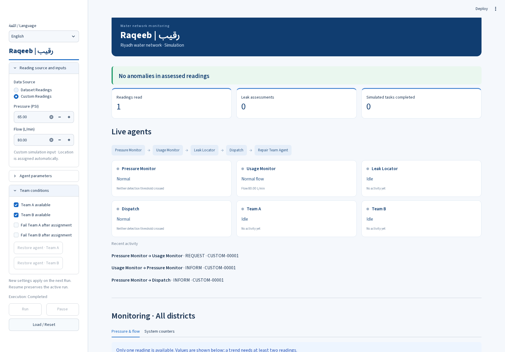
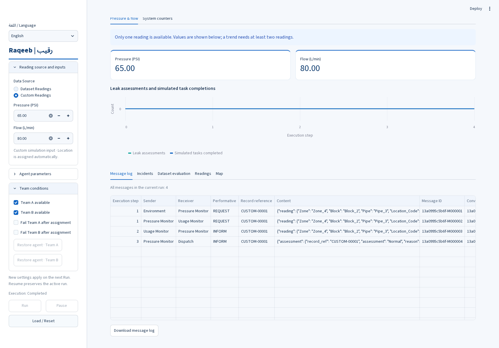
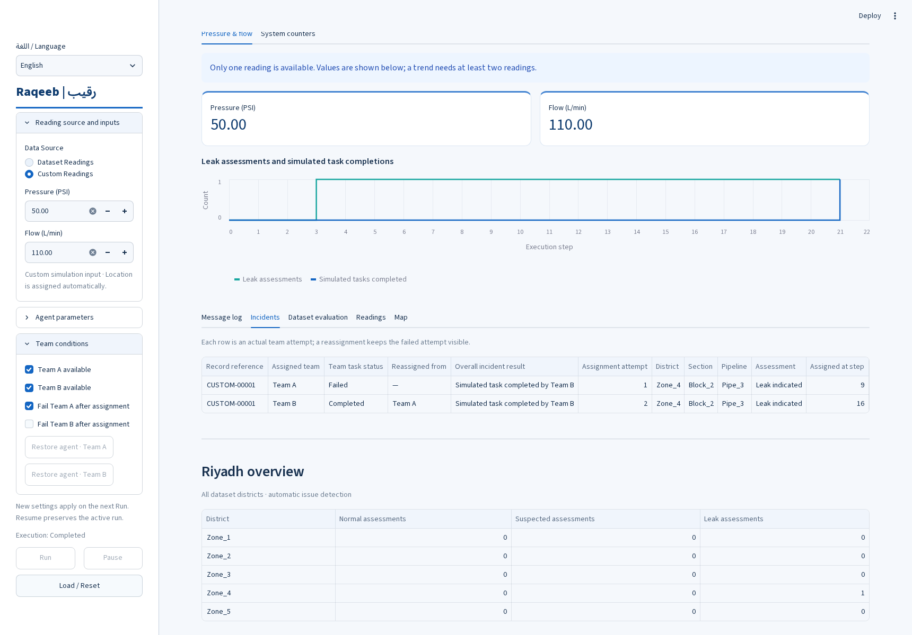

# Scenario execution results

Three custom-input scenarios executed through the Streamlit interface. Each scenario has exactly two screenshots: details (status and agents) and results (messages or incident history). Message JSON files contain the actual exported protocol log.

Common configuration: low pressure < 54 PSI; high flow > 90 L/min; major pressure ≤ 40 PSI after dual-rule assessment; task duration 4 steps; playback interval 0.5 seconds. Both teams initially available. Team positions and reading location assigned automatically. Assignment failures disabled except Team A in Scenario Three. These are simulated task outcomes, not physical repair evidence.

## 3.6.1 Scenario One: Normal Reading

**Initial conditions:** Pressure 65 PSI; flow 80 L/min; both teams available; assignment failures disabled.

**Observed behavior:** Both monitors found normal values. Dispatch received the Normal assessment. No CFP, offers or maintenance assignment occurred.

**Actual outcome:** Normal assessment recorded; no task assigned; 4 actual messages.

[Actual message log](01-normal-messages.json)

## 3.6.2 Scenario Two: Indicated Leak and Task Completion

**Initial conditions:** Pressure 50 PSI; flow 110 L/min; both teams available; assignment failures disabled.

**Observed behavior:** Pressure Monitor detected low pressure and Usage Monitor verified high flow. Leak Locator supplied the associated location. Dispatch requested offers from both teams, selected Team A, and assigned the task. Team A reported completion.

**Actual outcome:** Leak indicated; simulated task completed by Team A; 13 actual messages.

[Actual message log](02-leak-task-completed-messages.json)

## 3.6.3 Scenario Three: Team Failure and Reassignment

**Initial conditions:** Pressure 50 PSI; flow 110 L/min; both teams available; Team A assignment failure enabled.

**Observed behavior:** Dispatch initially assigned Team A. Team A reported failure after assignment. Dispatch requested new offers and reassigned the task to Team B. Team B completed it. The incident table retains Team A as Failed and Team B as Completed.

**Actual outcome:** Failed attempt preserved; reassignment from Team A to Team B succeeded; 19 actual messages.

[Actual message log](03-team-failure-reassignment-messages.json)
