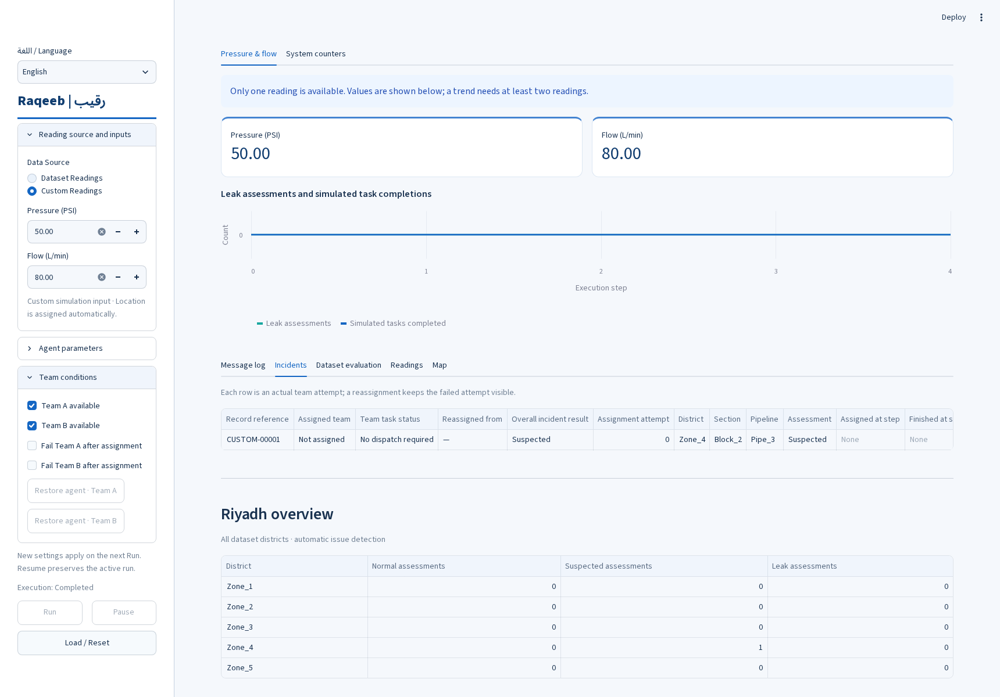
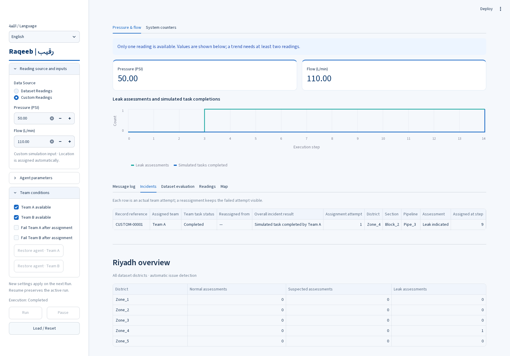
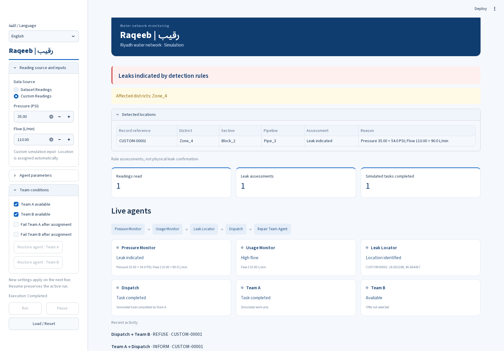
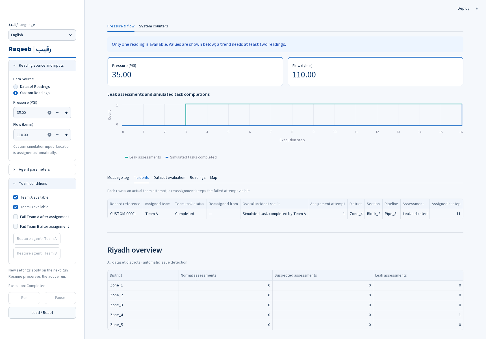
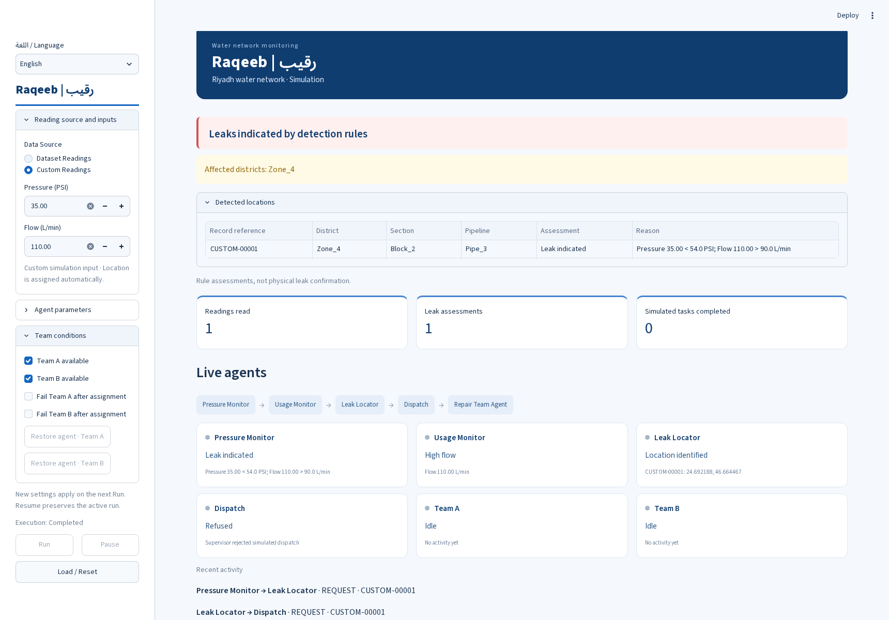
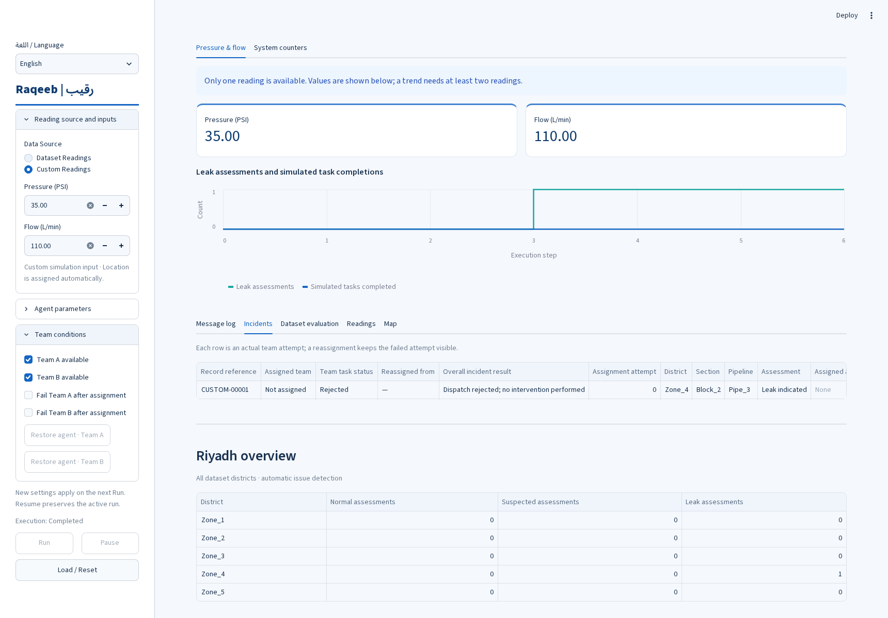
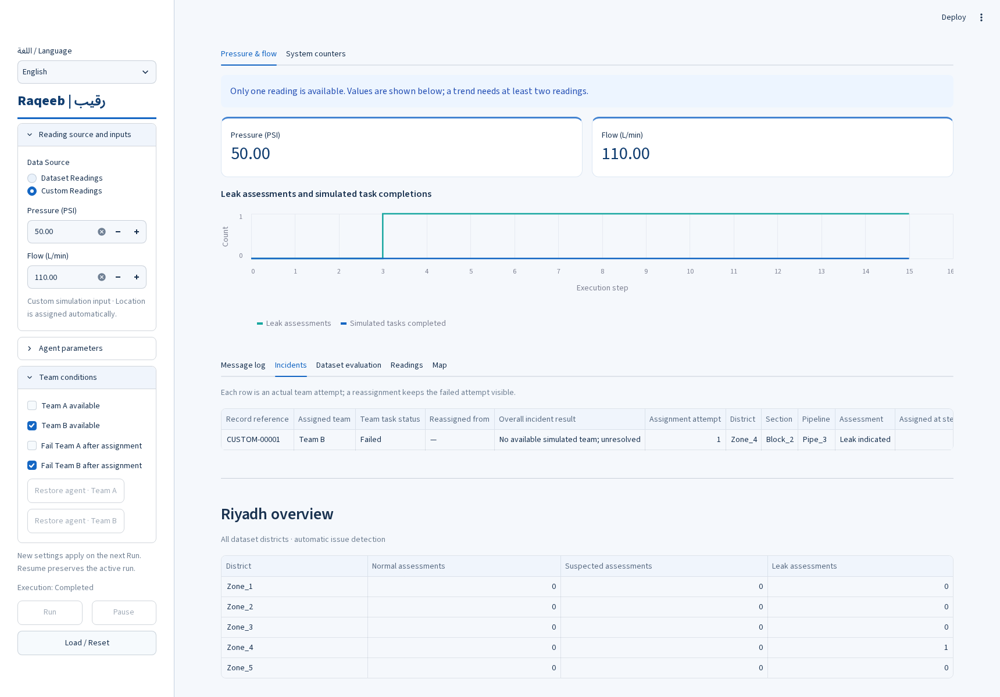
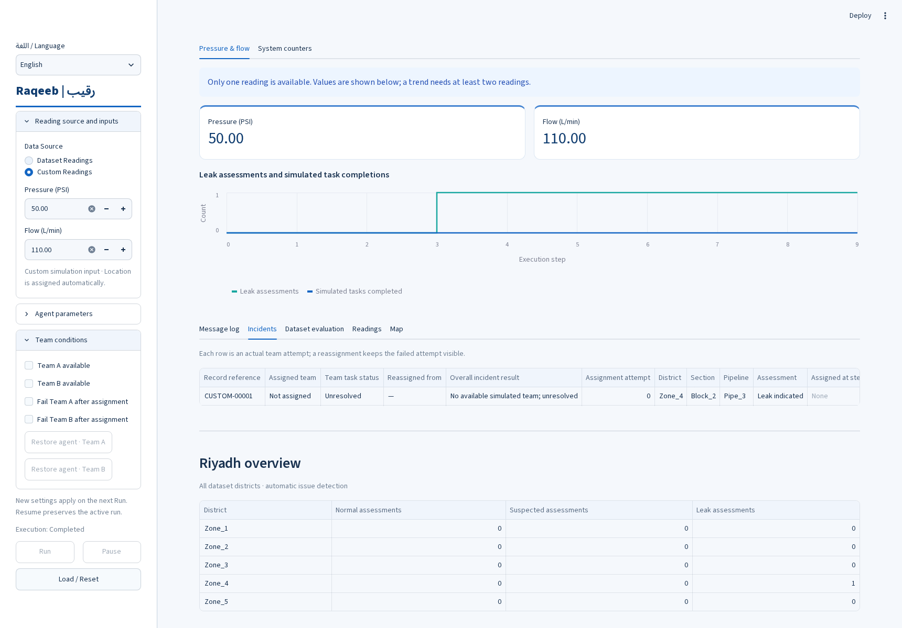

# صور تنفيذ رقيب ونتائجه

صور ملتقطة من تشغيل واجهة المشروع فعليًا بإدخالات يدوية. المواقع عُيّنت تلقائيًا من بيانات الرياض. حدود الكشف: الضغط أقل من 54 PSI، التدفق أكبر من 90 L/min، والبلاغ الكبير عند ضغط 40 PSI أو أقل بعد تحقق الشرطين. مدة المهمة 4 خطوات. هذه محاكاة وليست إثبات إصلاح ميداني.

لكل حالة صورتان: overview للحالة والوكلاء، والصورة الأخرى للمدخلات والنتائج. ملفات messages.json تحفظ كل الرسائل الفعلية. في حالة تعطل ب عُطّل توفر أ لضمان إسناد المهمة إلى ب؛ لذلك لم يكن هناك بديل بعد تعطله.

## حالة طبيعية
الضغط: 65 PSI · التدفق: 80 L/min · الرسائل: 4
الفرق المتعطلة: لا يوجد · الفرق التي أكملت المهمة: لا يوجد

## اشتباه بسبب انخفاض الضغط فقط
الضغط: 50 PSI · التدفق: 80 L/min · الرسائل: 4
الفرق المتعطلة: لا يوجد · الفرق التي أكملت المهمة: لا يوجد

## تسرب بالقواعد واكتمال المهمة
الضغط: 50 PSI · التدفق: 110 L/min · الرسائل: 13
الفرق المتعطلة: لا يوجد · الفرق التي أكملت المهمة: Team A

## تسرب كبير وموافقة المشرف
الضغط: 35 PSI · التدفق: 110 L/min · الرسائل: 14
الفرق المتعطلة: لا يوجد · الفرق التي أكملت المهمة: Team A

## تسرب كبير ورفض المشرف
الضغط: 35 PSI · التدفق: 110 L/min · الرسائل: 6
الفرق المتعطلة: لا يوجد · الفرق التي أكملت المهمة: لا يوجد

## تعطل أ ثم إعادة الإسناد إلى ب
الضغط: 50 PSI · التدفق: 110 L/min · الرسائل: 19
الفرق المتعطلة: Team A · الفرق التي أكملت المهمة: Team B

## تعطل ب مع عدم توفر أ
الضغط: 50 PSI · التدفق: 110 L/min · الرسائل: 15
الفرق المتعطلة: Team B · الفرق التي أكملت المهمة: لا يوجد

## عدم توفر الفريقين
الضغط: 50 PSI · التدفق: 110 L/min · الرسائل: 9
الفرق المتعطلة: لا يوجد · الفرق التي أكملت المهمة: لا يوجد

